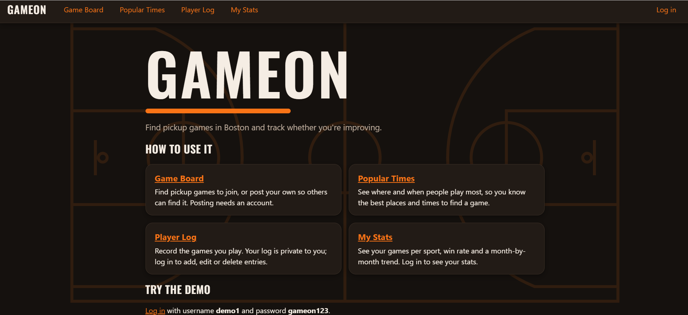

# GameOn

**Pickup games near you, stats for every game you play.**

GameOn helps Boston players find pickup basketball, soccer, tennis, volleyball and pickleball games at their level, and lets them log the games they play to see whether they are improving.



## Links

|                 |                                                                                                                                                   |
| --------------- | ------------------------------------------------------------------------------------------------------------------------------------------------- |
| Live site       | https://gameon-2ucs.onrender.com                                                                                                                  |
| Design document | [docs/design-document.pdf](docs/design-document.pdf)                                                                                              |
| Demo video      | TODO: add YouTube link                                                                                                                            |
| Slides          | [Google Slides](https://docs.google.com/presentation/d/1aBiUPgfA5-VDxHJTkpT-aQJwcgvXqwraVT5oYH9HuUY/edit?usp=sharing)                             |     |
| Class           | [CS5610 Web Development](https://johnguerra.co/classes/webDevelopment_online_fall_2026/), Northeastern University, Prof. John Alexis Guerra Gomez |

## Authors

- **Aaryan Nilesh Kathole**: Game Board (games collection, game CRUD, search with filters and pagination, Popular Times aggregation)
- **Aryan Sarode**: Player Log (playerLogs collection, log CRUD, history with filters and pagination, My Stats aggregation)
- **Both**: Express server, MongoDB connection, Passport login, deployment

## Project objective

In Boston, pickup games get organized in scattered group chats. Newcomers can't find a game at their level, and games fall apart when not enough people show up. GameOn has two independent features:

- **Game Board**: players post and find pickup games by sport, location, time and skill level, and see which courts and time slots are busiest.
- **Player Log**: players privately record the games they played and see stats on how they are doing.

Each feature has its own MongoDB collection seeded with 1,200 synthetic records.

## Demo login

| Username | Password    |
| -------- | ----------- |
| `demo1`  | `gameon123` |

`demo1` hosts about 20 games and has about 300 Player Log entries, so every page has data. `demo2` to `demo20` use the same password.

## Features

| Page                | Route                           | Login | What it does                                                                            |
| ------------------- | ------------------------------- | ----- | --------------------------------------------------------------------------------------- |
| Home                | `/`                             | No    | Explains each page and gives the demo login                                             |
| Log in / Register   | `/login`                        | No    | Log in or create an account                                                             |
| Game Board          | `/games`                        | No    | Browse upcoming games, filter by sport, neighborhood, skill level and date, 20 per page |
| Post / Edit a game  | `/games/new`, `/games/:id/edit` | Yes   | Create a game; only its host can edit or delete it                                      |
| Popular Times       | `/games/insights`               | No    | Busiest courts and time slots per sport, with a chart of games by hour                  |
| Player Log          | `/log`                          | Yes   | Your private game history, filter by sport, result and date range, 20 per page          |
| Log / Edit an entry | `/log/new`, `/log/:id/edit`     | Yes   | Record sport, date, location, duration, result, rating and notes                        |
| My Stats            | `/log/stats`                    | Yes   | Games per sport, win rate, hours played and a monthly trend chart                       |

## Tech stack

- **Frontend:** React with Hooks, built with Vite, React Router, fetch API, PropTypes, Chart.js
- **Backend:** Node.js and Express (ES modules)
- **Database:** MongoDB with the native Node.js driver (no Mongoose)
- **Authentication:** Passport local strategy with express-session and bcrypt
- **Tooling:** ESLint, Prettier, nodemon
- **Hosting:** Render (app) and MongoDB Atlas (database)

## Run it locally

### Prerequisites

- Node.js 22
- Docker Desktop (for a local MongoDB), or MongoDB Community Server

### Steps

1. Clone the repo and install both packages:

   ```bash
   git clone https://github.com/AryanSarode14/GameOn.git
   cd GameOn
   npm install
   cd frontend && npm install && cd ..
   ```

2. Start MongoDB:

   ```bash
   docker run -d --name gameon-mongo -p 27017:27017 mongo
   ```

   Next time, `docker start gameon-mongo` is enough.

3. Create your `.env` from the example and fill in the two values:

   ```bash
   cp .env.example .env
   ```

   ```
   MONGO_URI=mongodb://localhost:27017
   SESSION_SECRET=<any long random string>
   ```

   To generate a secret: `node -e "console.log(require('crypto').randomBytes(32).toString('hex'))"`

4. Seed the database (20 demo users, 1,200 games, 1,200 log entries):

   ```bash
   npm run seed
   ```

5. Start the backend and the frontend in two terminals:

   ```bash
   npm run dev
   ```

   ```bash
   cd frontend
   npm run dev
   ```

   Open http://localhost:5173. Vite proxies `/api` to the Express server on port 3000.

### Production build

```bash
npm run build
npm start
```

Express serves the built React app from `frontend/dist` on port 3000 (or `PORT`). On Render, set `MONGO_URI`, `SESSION_SECRET` and `NODE_ENV=production`.

### Scripts

| Where       | Script           | Does                                     |
| ----------- | ---------------- | ---------------------------------------- |
| Root        | `npm run dev`    | Start Express with nodemon               |
| Root        | `npm start`      | Start Express                            |
| Root        | `npm run seed`   | Seed users, then games, then player logs |
| Root        | `npm run build`  | Install and build the frontend           |
| Root        | `npm run lint`   | ESLint on the backend                    |
| Root        | `npm run format` | Prettier on the whole repo               |
| `frontend/` | `npm run dev`    | Vite dev server                          |
| `frontend/` | `npm run lint`   | ESLint on the frontend                   |

## API

| Method | Route                   | Login | Does                                       |
| ------ | ----------------------- | ----- | ------------------------------------------ |
| POST   | `/api/auth/register`    | No    | Create an account and log in               |
| POST   | `/api/auth/login`       | No    | Log in                                     |
| POST   | `/api/auth/logout`      | No    | Log out                                    |
| GET    | `/api/auth/me`          | No    | Current user or `null`                     |
| GET    | `/api/games`            | No    | Upcoming games with filters and pagination |
| GET    | `/api/games/options`    | No    | Sports, skill levels and courts            |
| GET    | `/api/games/insights`   | No    | Popular courts and time slots              |
| GET    | `/api/games/:id`        | No    | One game                                   |
| POST   | `/api/games`            | Yes   | Create a game                              |
| PUT    | `/api/games/:id`        | Host  | Update a game                              |
| DELETE | `/api/games/:id`        | Host  | Delete a game                              |
| GET    | `/api/playerLogs`       | Yes   | Your entries with filters and pagination   |
| GET    | `/api/playerLogs/stats` | Yes   | Your stats aggregation                     |
| GET    | `/api/playerLogs/:id`   | Yes   | One of your entries                        |
| POST   | `/api/playerLogs`       | Yes   | Create an entry                            |
| PUT    | `/api/playerLogs/:id`   | Yes   | Update your entry                          |
| DELETE | `/api/playerLogs/:id`   | Yes   | Delete your entry                          |

## Project structure

```
GameOn/
├── server.js            Express app, sessions, Passport, routes
├── auth/                Passport local strategy
├── db/                  MongoDB connection and one module per collection
├── routes/              auth, games, playerLogs
├── middleware/          requireLogin
├── scripts/             seed scripts
├── docs/                design document and screenshot
└── frontend/
    └── src/
        ├── context/     UserContext
        └── components/  one .jsx and one .css per component
```

## AI disclosure

## License

[MIT](LICENSE)
